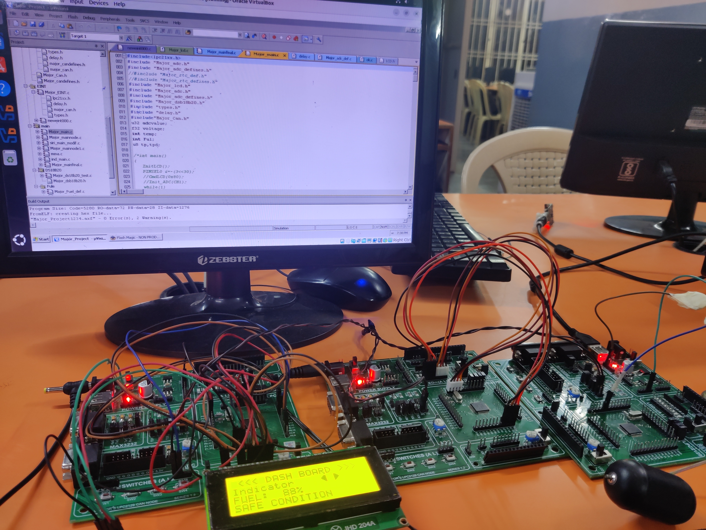
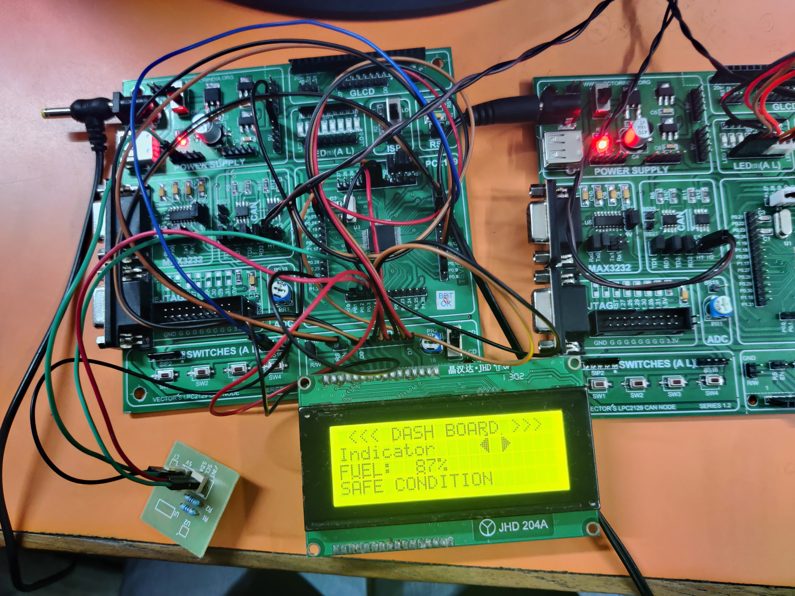
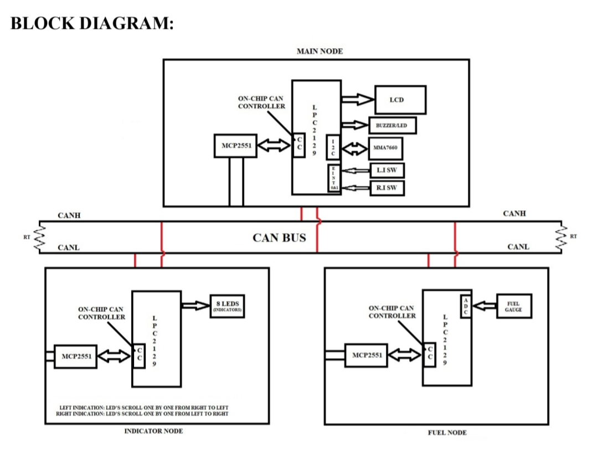

# 🚗 AutoGuard CAN: Intelligent Automotive Safety & Monitoring System

## 📌 Overview

AutoGuard CAN is an embedded automotive safety and monitoring system developed using the LPC2129 ARM7 microcontroller and Controller Area Network (CAN) protocol.

The system consists of three independent CAN nodes that communicate with each other to monitor vehicle parameters and provide safety-related information.

It monitors fuel level, controls left and right indicators, and detects crash conditions using an MMA7660 accelerometer. The system displays relevant information and crash-related indications on an LCD.

## 🎯 Objectives

- Develop a multi-node automotive monitoring system using CAN communication.
- Monitor vehicle fuel level using ADC.
- Detect crash conditions using an accelerometer.
- Display vehicle status and safety-related information on LCD.
- Control left and right indicators through CAN communication.
- Demonstrate communication between multiple embedded nodes.

## ✨ Features

- 🚗 CAN-based communication between three nodes.
- ⛽ Fuel percentage monitoring using ADC.
- 🛡️ Crash condition detection using MMA7660 accelerometer.
- 📟 LCD-based system status and airbag indication.
- 💡 Left and right indicator control.
- 🔄 Message-based communication between nodes.
- ⚡ Real-time monitoring and control.

## 🏗️ System Architecture

The project consists of three independent nodes.

### 1. Main Node

Responsibilities:

- Receives fuel percentage from Fuel Node through CAN.
- Monitors accelerometer data using I2C communication.
- Detects crash conditions based on the configured threshold.
- Displays fuel information and crash-related airbag indication on LCD.
- Sends left and right indicator commands to Indicator Node through CAN.

### 2. Fuel Node

Responsibilities:

- Reads the analog signal from the fuel gauge using ADC.
- Converts the analog input into a digital value.
- Calculates the fuel percentage.
- Sends fuel percentage to Main Node through CAN.

### 3. Indicator Node

Responsibilities:

- Receives indicator commands from Main Node through CAN.
- Controls left indicator LEDs.
- Controls right indicator LEDs.
- Turns indicators OFF according to the received command.

## 🔄 CAN Communication Flow

```text
       Fuel Node
           |
           | Fuel Percentage
           | CAN
           ▼
        Main Node
           |
           | Indicator Commands
           | CAN
           ▼
      Indicator Node
```

## 🛠️ Hardware Requirements

- LPC2129 ARM7 Microcontroller
- MCP2551 CAN Transceiver
- MMA7660 Accelerometer
- Fuel Gauge
- LCD Display
- Indicator LEDs
- Push Buttons

## 💻 Software Requirements

- Embedded C
- Keil µVision4
- Proteus 8 Professional
- Flash Magic

## 📂 Project Structure

```text
AutoGuard-CAN/
│
└── Major_Project/
    │
    └── Target 1
        │
        └── Source Group 1
            │
            ├── Startup.s
            ├── delay.c
            ├── type.h
            ├── Major_adc.h
            ├── Major_adc_defines.h
            ├── Major_adc_def.c
            │   ├── lpc21xx.h
            │   ├── types.h
            │   └── delay.h
            │
            ├── pinconnect.c
            │   └── LPC21xx.h
            │
            ├── LCD
            │   ├── Major_lcd.c
            │   │   ├── LPC21xx.h
            │   │   ├── delay.h
            │   │   ├── LCD.h
            │   │   ├── types.h
            │   │   └── macros.h
            │   └── Major_lcd.h
            │
            ├── CAN
            │   ├── Major_Can.c
            │   │   ├── LPC21xx.h
            │   │   ├── types.h
            │   │   ├── delay.h
            │   │   ├── Major_candefines.h
            │   │   └── Major_can.h
            │   ├── Major_Can.h
            │   └── Major_candefines.h
            │
            ├── EINT
            │   └── neweint000.c
            │
            ├── main
            │   └── Major_mainfinal.c
            │
            ├── DS18B20
            │   └── Major_dsb18b20.h
            │
            └── Fule
                ├── Major_Fuel.h
                └── ok.c
```

*Note: This structure represents the Keil µVision project organization and header file relationships.*

## ⚙️ Working Principle

1. Fuel Node reads the analog fuel gauge signal using ADC.
2. It converts the ADC reading into a digital value and calculates the fuel percentage.
3. Fuel percentage is transmitted to Main Node through CAN.
4. Main Node receives and processes fuel information.
5. MMA7660 accelerometer provides acceleration data through I2C.
6. Main Node checks the accelerometer readings against the configured crash threshold.
7. When the crash condition is detected, the corresponding airbag indication is displayed on LCD.
8. Indicator commands are generated by Main Node and transmitted through CAN.
9. Indicator Node receives the commands and controls the corresponding LEDs.

## 📡 Communication Protocols and Peripherals

- CAN – Communication between three nodes.
- I2C – MMA7660 accelerometer interfacing.
- ADC – Analog fuel signal measurement.
- GPIO – Indicator and switch interfacing.
- LCD – Vehicle status and safety information display.

## 🧠 Embedded Concepts Used

- ARM7 LPC2129 Architecture
- Embedded C Programming
- CAN Protocol
- ADC Interfacing
- I2C Communication
- GPIO Interfacing
- Sensor Interfacing
- LCD Interfacing
- Multi-node Embedded Communication

## 🚀 Future Scope

- GPS-based vehicle location tracking.
- GSM-based emergency alert system.
- Mobile application for vehicle monitoring.
- Cloud-based vehicle data monitoring.
- Advanced accident notification system.

## 👨‍💻 Developed By

**Ashok Danga**

B.Tech – Electronics & Telecommunication Engineering

## Project Images

### Hardware Setup


### Dashboard Output


### System Block Diagram


